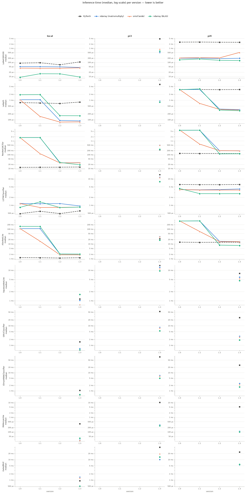
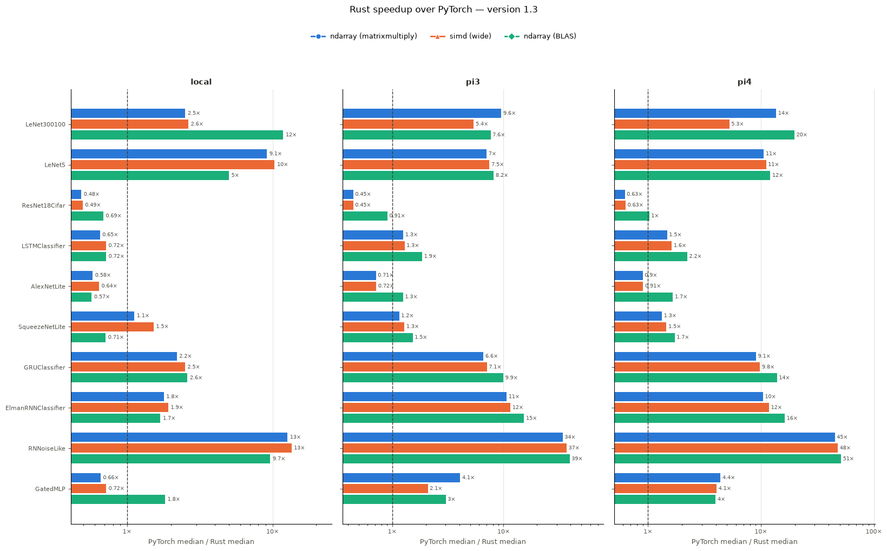

# Benchmark results

Results obtained by running `poetry run python benchmark.py`. It runs a benchmark based on what is configured in [the config file](benchmark_config.json). 

It will run the following models. All of them except RNNoiseLike are small classifiers with 10 output classes, picked to exercise different operator mixes (dense, convolution, residual/batch-norm, recurrent) at very different compute budgets.

|                        Model                         |     Family      |         Input          | Parameters | Operators exercised                                             |
| :--------------------------------------------------: | :-------------: | :--------------------: | :--------: | :-------------------------------------------------------------- |
|    [LeNet300100](#results-for-model--lenet300100)    | Fully connected | 784 (flattened 28x28)  |   ~267 K   | Linear, ReLU                                                    |
|         [LeNet5](#results-for-model--lenet5)         |    Small CNN    |        1x32x32         |   ~62 K    | Conv2d (5x5), MaxPool2d, Linear, ReLU                           |
|  [ResNet18Cifar](#results-for-model--resnet18cifar)  |  Residual CNN   |        3x32x32         |  ~15.4 M   | Conv2d (3x3, 1x1, 4x4), BatchNorm2d, residual add, ReLU, Linear |
| [LSTMClassifier](#results-for-model--lstmclassifier) |    Recurrent    | 20 steps x 64 features |   ~233 K   | 2-layer LSTM, Linear, multiple onnx layers                      |
|    [AlexNetLite](#results-for-model--alexnetlite)    |  Mid-size CNN   |        3x64x64         |  ~1.03 M   | Conv2d (7x7, 5x5, 3x3), MaxPool2d, Linear, ReLU                 |
|          [SqueezeNetLite](#squeezenetlite)           |   Compact CNN   |        3x64x64         |   ~123 K   | Conv2d (3x3, 1x1), MaxPool2d, Concat, AvgPool2d, ReLU           |
|           [GRUClassifier](#gruclassifier)            |    Recurrent    | 20 steps x 64 features |   ~175 K   | 2-layer GRU, Linear, Softmax                                    |
|      [ElmanRNNClassifier](#elmanrnnclassifier)       |    Recurrent    | 50 steps x 32 features |   ~55 K    | 2-layer RNN (tanh), Linear                                      |
|             [RNNoiseLike](#rnnoiselike)              | Audio denoising | 1 frame x 42 features  |   ~88 K    | GRU, Concat, Reshape, Linear, Tanh, Sigmoid                     |
|                [GatedMLP](#gatedmlp)                 | Fully connected |          512           |  ~5.26 M   | Linear, Sigmoid, elementwise Mul                                |

For more details on the models, see [the model chapter](#model-descriptions).

The results were obtained on the following machines, labelled `local`, `pi4` and `pi3` in the results:

| Device  | Hardware                | CPU                                                                  |  RAM  | OS                                          | PyTorch threads |
| :-----: | :---------------------- | :------------------------------------------------------------------- | :---: | :------------------------------------------ | :-------------: |
| `local` | Desktop PC              | Intel Core i5-10400 (x86_64, 6 cores / 12 threads, 2.9 GHz, AVX2)    | 16 GB | Ubuntu 22.04 under WSL2 (Windows)           |        6        |
|  `pi4`  | Raspberry Pi 4 Model B  | Broadcom BCM2711, 4x Cortex-A72 (aarch64, 1.8 GHz, NEON)             | 4 GB  | Raspberry Pi OS 64-bit (Debian 12 bookworm) |        4        |
|  `pi3`  | Raspberry Pi 3 Model B+ | Broadcom BCM2837B0, 4x Cortex-A53 (aarch64, in-order, 1.4 GHz, NEON) | 1 GB  | Raspberry Pi OS 64-bit (Debian 11 bullseye) |        4        |

## Results

Detailed results per version (of the rust package) can be found in the [benchmark_results](benchmark_results/) folder. Results for latest unpublished version are still work in progress.

### Overall results

### Improvements on latest version vs base python

---

## Model descriptions

### LeNet300100
The classic fully connected baseline from LeCun et al. (1998): three Linear layers over a flattened 28x28 image (784 -> 300 -> 100 -> 10) with ReLU in between. It is the dense-only reference the original LeNet-5 paper compared its convolutional design against. It is the cheapest model here and mostly measures raw matrix-vector/matrix-multiply speed and per-call overhead.

### LeNet5
The convolutional counterpart from the same paper: two Conv2d (5x5) + ReLU + MaxPool2d (2x2) stages over a 32x32 single-channel input (32x32 -> 28x28 -> 14x14 -> 10x10 -> 5x5, with 6 then 16 channels), followed by three Linear layers (400 -> 120 -> 84 -> 10). It is a small, convolution-dominated workload with tiny channel counts.

### ResNet18Cifar
ResNet-18 (He et al., 2015) keeping the original structure of 8 BasicBlocks (2 per stage, 4 stages, channels 64/128/256/512). Each block has two 3x3 conv + BatchNorm layers and a residual add, with a 1x1 conv + BatchNorm shortcut when the stride or channel count changes. Two adaptations are made for benchmarking:
- The ImageNet 7x7 stem + max-pool is replaced by a plain 3x3 conv stem, so it stays practical on 32x32 CIFAR-style inputs.
- The final global average pool is replaced by a kernel-matched 4x4 Conv2d (4x4 feature map -> 1x1), so the whole model only uses Conv2d, BatchNorm2d, ReLU, elementwise add and Linear, which are the operators the Rust runner supports.

It is by far the heaviest model here and stresses convolution throughput, memory traffic and batch-norm handling.

### LSTMClassifier
A 2-layer LSTM (Hochreiter & Schmidhuber, 1997) with hidden size 128, run over a synthetic sequence of 20 steps with 64 continuous features per step (no embedding lookup), followed by a Linear head (128 -> 10) on the final time step's output. The input layout is `(seq_len, batch, input_size)`, the default of `nn.LSTM`. It tests recurrent execution: many small, sequentially dependent matrix multiplications plus gate activations.

### AlexNetLite
An AlexNet-style (Krizhevsky et al., 2012) network: 5 Conv2d + ReLU layers (7x7 stride 2, 5x5, then three 3x3), with MaxPool2d (3x3, stride 2) after the 1st, 2nd and 5th, feeding 3 Linear layers (864 -> 512 -> 256 -> 10). It is scaled down to a 64x64 input (instead of 224x224) with narrower channels so that repeated forward passes stay quick, especially on a Raspberry Pi. Local Response Normalization from the original is dropped, as in most modern reimplementations, since minimal inference engines rarely support it. It sits between LeNet5 and ResNet18Cifar in compute and uses larger kernels and strided convolutions.

### SqueezeNetLite
A SqueezeNet 1.1-style network (Iandola et al., 2016): a strided 3x3 conv stem and MaxPool2d, then four Fire modules (a 1x1 "squeeze" conv feeding parallel 1x1 and 3x3 "expand" convs whose outputs are concatenated along channels), with a MaxPool2d after the second. There is no Linear layer: a 1x1 conv maps to 10 classes and a 7x7 AvgPool2d does the global average pool. It runs on a 64x64 input with the original 1.1 channel widths for those Fire modules. It covers channel-wise Concat and AvgPool on top of many cheap 1x1 convolutions.

### GRUClassifier
The GRU (Cho et al., 2014) counterpart of LSTMClassifier: a 2-layer GRU with hidden size 128 over 20 steps of 64 features, with a Linear head and a Softmax on the last time step. It has three gates per step instead of four, so it should be a bit cheaper than the LSTM.

### ElmanRNNClassifier
A 2-layer Elman RNN (Elman, 1990; `nn.RNN` with tanh) with hidden size 128 over 50 steps of 32 features, followed by a Linear head on the last time step. Each step is a single gate, so the sequence is longer to keep the workload meaningful. It is the most sequential and least compute-bound of the recurrent models.

### RNNoiseLike
The topology of RNNoise (Valin, 2018), a real-time speech denoiser. A tanh Dense layer over 42 audio features feeds three stacked GRUs (VAD 24, noise 48, denoise 96), where each later GRU reads the concatenation of earlier outputs and the input, and a sigmoid Dense layer outputs 22 band gains. As in deployment it processes one 10 ms frame per call, so this measures per-frame latency (the GRU state starts from zero each call). Differences from the original: `nn.GRU`'s tanh replaces its ReLU GRU activation, and only the gains are returned, not the VAD output.

### GatedMLP
Three Gated Linear Unit blocks (Dauphin et al., 2017) of width 1024 over a 512-feature input, followed by a Linear head. Each block computes `Linear_a(x) * sigmoid(Linear_b(x))`. It is a dense, matrix-vector-heavy workload like LeNet300100 but much larger, and it covers Sigmoid and elementwise Mul between two activations.

> Parameter counts are for the learnable weights and biases (BatchNorm running statistics excluded) and are rounded.
